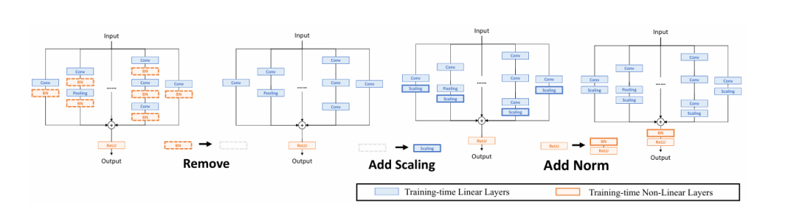
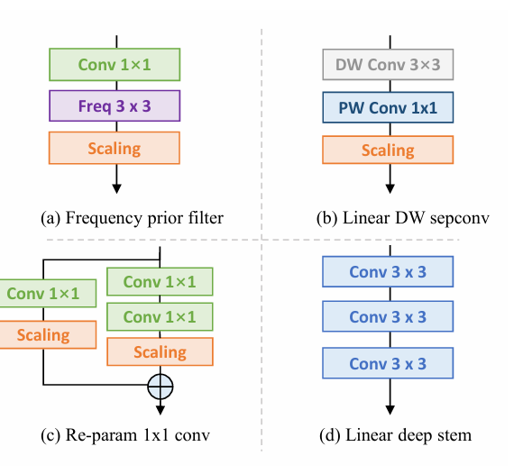
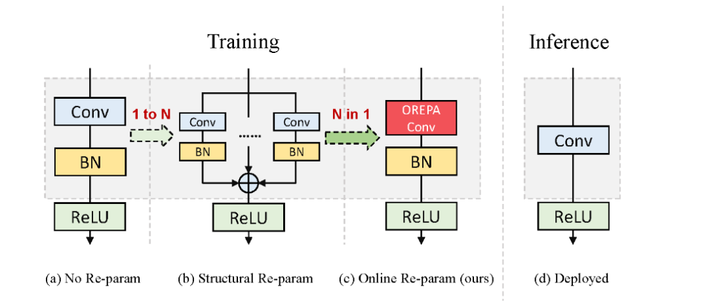
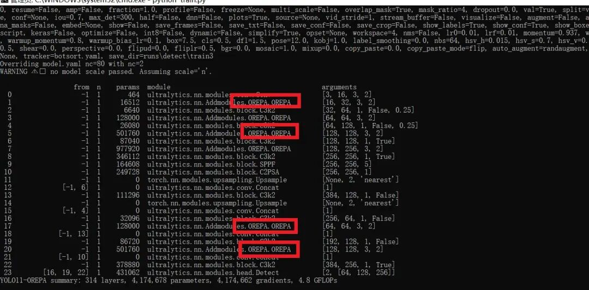

# [yolov11 Improvement Series] Online Reparameterization of Convolutions (OREPA) based on YOLOv11 for inference acceleration in Python source code + training code.

[OREPA Introduction] The reparameterization of the structure in deep learning has attracted increasing attention in various computer vision tasks. It aims to improve the performance of deep models without introducing any inference time cost.

[OREPA Introduction]

## Abstract

Structured reparameterization has attracted increasing attention in various computer vision tasks. It aims to improve the performance of deep models without introducing any inference time cost. Although efficient during inference, these models rely on complex training blocks for high accuracy during complex training stages, leading to additional substantial training costs. This paper introduces Online Reparameterization of Convolutions (OREPA), a two-stage process aimed at reducing massive training costs by compressing complex training block stages into single convolutions. To achieve this goal, we introduce a linear scaling layer to better optimize online blocks. While reducing training costs, we also explore more effective reparameterization components. Compared to state-of-the-art reparameterization models, OREPA can reduce training time memory overhead by about 70% and speed up training by approximately 2x. Meanwhile, equipped with OREPA, these models outperform previous methods by up to +0.6% on ImageNet, improving their performance consistently. We also conduct experiments on object detection and semantic segmentation and demonstrate consistent improvements for downstream tasks.

# Fundamental Principles

## What is structural reparameterization?

Structure reparameterization is a method for optimizing model performance during the training and inference stages of neural networks. Its fundamental idea is to enhance the model's expressiveness and performance by using complex, multi-branch network structures in the training phase, and then reparameterize these complex structures into simpler equivalent structures during the inference phase to reduce computational overhead and storage requirements.

Specifically, the re-parameterization of the structure usually involves the following steps:

1.

1.

**Training phase**:

-

-

Training with complex network architectures. For example, a convolutional layer may be replaced with multiple parallel convolutional layers and skip connections to enhance the model's expressiveness and learning capabilities.

-

-

This complex structure can capture more features, helping the model to better fit the data during training.

-

1.

1.

**Reparameterization**:

-

-

After training, transform the complex multi-branch structure into an equivalent simple one. For example, merge the weights and biases of multiple parallel convolutional layers into a single convolutional layer.

-

-

This transformation is achieved through mathematical methods and equivalent transformations, ensuring that the model's output remains unchanged during the inference phase.

-

1.

1.

**Inference Stage**:

-

-

Use the reparameterized simple structure for inference. The reason is that the structure is simpler, and thus the computational efficiency of inference is higher, the latency is lower, and the storage resources required are also less.

-

-

This optimization is particularly useful for models deployed on resource-constrained devices (such as mobile devices).

-

A common application of structure re-parameterization is the RepVGG model. In the training phase, RepVGG employs a multi-branch architecture, while in the inference phase, it is re-parameterized into a simple VGG-like convolutional neural network, thus achieving high performance and efficiency. The advantage of this method lies in its ability to significantly reduce computational and storage demands during the inference phase without compromising model performance, thereby enabling faster inference speeds and lower resource utilization.

## OREPA Key Points

1.

1. **Online optimization phase**

During this phase, OREPA optimizes the performance of convolutional layers by removing non-linear components and introducing linear scaling layers. By eliminating non-linear components, the model becomes easier to optimize. The introduction of linear scaling layers enhances the flexibility and optimization effectiveness of the model.

1.

1. **Compression training module stage**

At this stage, OREPA compresses complex training time modules into a single convolutional operation to reduce training costs. By simplifying the structure by combining multiple convolutional layers and batch normalization layers into a simple convolutional layer, memory and computational costs are reduced. The design of this compression structure helps improve training efficiency.

1.

1. **Linear Scaling Layer**

The linear scaling layer is a key component of OREPA, enhancing the model's flexibility and optimization effectiveness through appropriate weight scaling. This linear scaling layer replaces the original non-linear normalization layer, maintaining the diversity of optimization and representation capabilities. The introduction of the linear scaling layer aids in optimizing the training process of the model and enhances its performance.

1.

1. **Training Module Compression**

OREPA reduces the complexity and resource consumption during training by compressing complex training-time modules into a single convolutional operation. The design of this compression structure enables all models to be simplified into a single convolutional layer at inference, thereby enhancing inference speed and reducing resource consumption. The process of compressing training-time modules aids in simplifying model architecture and improving both training and inference efficiency.

OREPA can simplify complex training time blocks into a single convolutional layer while maintaining high accuracy. The overall process of OREPA is shown in Figure 2, which includes the block linearization stage and the block compression stage.

 Edit

-

-

Block linearization

During training, the intermediate normalization layers hinder the merging of individual layers, but directly removing them can lead to performance issues. To address this dilemma, a channel-level linear scaling operation is introduced as a linear replacement for normalization. The scaling layer contains a learnable vector that scales feature maps in the channel dimension. The linear scaling layer functions similarly to the normalization layer, encouraging multiple branches to optimize in different directions, which is key to improving performance through reparameterization. A detailed analysis of its specific impact will be discussed in Section 3.4. In addition to its impact on performance, the linear scaling layer can also be merged during training, enabling online reparameterization.

Based on the linear scaling layer, modify the reparameterization block as shown in Figure 3. Specifically, the block linearization phase includes the following three steps:

Once the linearization phase is completed, only linear layers exist in the re-param block, which means all components within the block can be merged during the training phase.

Due to the significant reduction in training costs proposed by OREPA, it enables exploration of more complex training blocks. To this end, a new reparameterization model, OREPA-ResNet, was designed by linearizing the state-of-the-art DBB model and incorporating the following components (Figure 5).

```
In previous work, pooling layers were used within the blocks. Qin et al. believed that pooling layers are a type of frequency filter. To this end, a Conv1×1 frequency filter branch was added.

```

 Edit

### Block Compression

Thanks to the linearization of blocks, a linear block is obtained. The block compression step transforms operations on the intermediate feature map into more efficient kernel operations. This reduces the additional training cost from (O(H \times W)) to (O(K_H \times K_W)), where (H) and (W) are the spatial dimensions of the feature maps, and (K_H) and (K_W) are the sizes of the convolutional kernels.

Generally speaking, regardless of how complex the linear reparameterization block is, the following two properties are always valid:

 Edit

-

-

All linear layers in the block, such as depthwise convolutions, average pooling, and linear scaling layers, can be represented with degenerated convolutional layers and have a corresponding set of parameters.

-

-

Blocks can be represented by a series of parallel branches, each consisting of a series of convolutional layers.

-

-

-

Linear depth separable convolution

A slight modification was made to the deep separable convolution, removing the intermediate non-linear activation layer so that it can be combined during training.

-

-

1×1 convolution reparameterization

Previous work focused mainly on reparameterization of 3×3 convolutional layers, neglecting the 1×1 layer. It is recommended to reparameterize the 1×1 layer as they play a crucial role in bottleneck architectures. Specifically, an additional Conv1×1 - Conv1×1 branch has been added.

-

-

Linear deep stem

Large convolutional kernels are typically placed at the initial layers, such as 7×7 stem layers, to achieve a larger receptive field. Guo et al. replaced the 7×7 convolutional layer with stacked 3×3 layers.

-

-

-

Frequency Prior Filter

-

1.

1. **Remove all non-linear layers**

Remove all non-linear layers in the reparameterization block, such as normalization layers.

1.

1. **Add a scale layer**

Add a scale layer at the end of each branch, i.e., a linear scaling layer to maintain diversity in optimization.

1.

1. **Added Normalization Layer**

After merging all branches, add a post-normalization layer to stabilize the training process.

1.

[Introduction to YOLOv11 Framework]

On September 30, 2024, Ultralytics officially released YOLOv11 during its event YOLOVision. YOLOv11 is the latest version of YOLO, developed by the team from both the United States and Spain, Ultralytics. YOLO stands for You Only Look Once, a computer vision algorithm used in image-based artificial intelligence.

### Ultralytics YOLO11 Overview

YOLO11 is the latest version of the Ultralytics YOLO series of real-time object detectors, redefining possibilities with cutting-edge precision, speed, and efficiency. Building on impressive advancements from previous YOLO versions, YOLO11 introduces significant improvements in architecture and training methods, making it a versatile choice for various computer vision tasks.


Editor

Key Features

-

-

Enhanced feature extraction: YOLO11 employs an improved backbone and neck architecture, enhancing feature extraction capabilities to achieve more precise object detection and complex task performance.

-

-

Optimization for efficiency and speed: YOLO11 introduces refined architecture design and optimized training pipelines, providing faster processing speeds while maintaining the best balance between accuracy and performance.

-

-

Achieving higher accuracy with fewer parameters: With the advancement of model design, YOLOv11m has achieved higher average precision (mAP) on the COCO dataset while using 22% fewer parameters than YOLOv8m, thereby improving computational efficiency without compromising accuracy.

-

-

Cross-environment adaptability: YOLO11 can be seamlessly deployed in various environments, including edge devices, cloud platforms, and systems supporting NVIDIA GPUs, ensuring maximum flexibility.

-

-

Supports a wide range of tasks: whether it's object detection, instance segmentation, image classification, pose estimation, or Oriented Object Detection (OBB), YOLO11 aims to tackle various computer vision challenges.

 Edit

#### Compared to previous versions, what are the key improvements in Ultralytics YOLO11?

Ultralytics YOLO11 introduces several significant improvements compared to its predecessor. The main improvements include:

-

-

Enhanced feature extraction: YOLO11 employs an improved backbone and neck architecture, enhancing feature extraction capabilities to achieve more precise object detection.

-

-

Optimized efficiency and speed: Precise architectural design and optimized training pipelines provide faster processing speeds while maintaining a balance between accuracy and performance.

-

-

Achieving higher accuracy with fewer parameters: YOLOv11m achieves higher average precision (mAP) on the COCO dataset, reducing its parameters by 22% compared to YOLOv8m, while improving computational efficiency without compromising accuracy.

-

-

Cross-environment adaptability: YOLO11 can be deployed across various environments, including edge devices, cloud platforms, and systems supporting NVIDIA GPUs.

-

-

Supports a wide range of tasks: YOLO11 supports various computer vision tasks, such as object detection, instance segmentation, image classification, pose estimation, and Oriented Object Detection (OBB).

[Test Environment]

windows10 x64

ultralytics==8.3.0

torch==2.3.1

[Improvement Process]

1. Add a new OREPA.py implementation module (the code is too extensive, the core module source code can refer to the improvement steps.docx). Then create a __init__.py file under the same directory and write the code.

from .OREPA import *

#### 2. File modification steps

**Modify tasks.py file**

**Create Model Configuration File**

The content of yolo11-OREPA.yaml is as follows:

```
# Ultralytics YOLO 🚀, AGPL-3.0 license
# YOLO11 object detection model with P3-P5 outputs. For Usage examples see https://docs.ultralytics.com/tasks/detect
# Parameters
nc: 80 # number of classes
scales: # model compound scaling constants, i.e. 'model=yolo11n.yaml' will call yolo11.yaml with scale 'n'
  # [depth, width, max_channels]
  n: [0.50, 0.25, 1024] # summary: 319 layers, 2624080 parameters, 2624064 gradients, 6.6 GFLOPs
  s: [0.50, 0.50, 1024] # summary: 319 layers, 9458752 parameters, 9458736 gradients, 21.7 GFLOPs
  m: [0.50, 1.00, 512] # summary: 409 layers, 20114688 parameters, 20114672 gradients, 68.5 GFLOPs
  l: [1.00, 1.00, 512] # summary: 631 layers, 25372160 parameters, 25372144 gradients, 87.6 GFLOPs
  x: [1.00, 1.50, 512] # summary: 631 layers, 56966176 parameters, 56966160 gradients, 196.0 GFLOPs
# YOLO11n backbone
backbone:
  # [from, repeats, module, args]
  - [-1, 1, Conv, [64, 3, 2]] # 0-P1/2
  - [-1, 1, OREPA, [128, 3, 2]] # 1-P2/4
  - [-1, 2, C3k2, [256, False, 0.25]]
  - [-1, 1, OREPA, [256, 3, 2]] # 3-P3/8
  - [-1, 2, C3k2, [512, False, 0.25]]
  - [-1, 1, OREPA, [512, 3, 2]] # 5-P4/16
  - [-1, 2, C3k2, [512, True]]
  - [-1, 1, OREPA, [1024, 3, 2]] # 7-P5/32
  - [-1, 2, C3k2, [1024, True]]
  - [-1, 1, SPPF, [1024, 5]] # 9
  - [-1, 2, C2PSA, [1024]] # 10
# YOLO11n head
head:
  - [-1, 1, nn.Upsample, [None, 2, "nearest"]]
  - [[-1, 6], 1, Concat, [1]] # cat backbone P4
  - [-1, 2, C3k2, [512, False]] # 13
  - [-1, 1, nn.Upsample, [None, 2, "nearest"]]
  - [[-1, 4], 1, Concat, [1]] # cat backbone P3
  - [-1, 2, C3k2, [256, False]] # 16 (P3/8-small)
  - [-1, 1, OREPA, [256, 3, 2]]
  - [[-1, 13], 1, Concat, [1]] # cat head P4
  - [-1, 2, C3k2, [512, False]] # 19 (P4/16-medium)
  - [-1, 1, OREPA, [512, 3, 2]]
  - [[-1, 10], 1, Concat, [1]] # cat head P5
  - [-1, 2, C3k2, [1024, True]] # 22 (P5/32-large)
  - [[16, 19, 22], 1, Detect, [nc]] # Detect(P3, P4, P5)

```

#### 3. Verification of integration

Search for the source code of futureflsl/yolo-improve using Git, then use the newly created yaml configuration file to start the training task.

```
from ultralytics import YOLO
if __name__ == '__main__':
    model = YOLO('yolo11-OREPA.yaml')  # build from YAML and transfer weights
        # Train the model
    results = model.train(data='coco128.yaml',epochs=100, imgsz=640, batch=8, device=0, workers=1, save=True,resume=False)
```

After successful integration, the training log will display initialization information for the OREPA module, indicating that it has been correctly loaded into the model.

 Edit

[Training Instructions]

Step 1: First, install the necessary modules for YOLOv11. You can refer to the installation process of the YOLOv11 framework. Then, uninstall the official version of pip by running `pip uninstall ultralytics`. Finally, install the improved source code by running `pip install .`
Step 2: Place your dataset in a folder named 'dataset' and ensure that the folder names remain unchanged.
Step 3: Open the train.py, coco128.yaml, and model parameters yaml files separately and modify the necessary parameters. Finally, execute `python train.py` to train.

[Provided Files]

```
├── [Official Source Code]ultralytics-8.3.0.zip
├── train/
│   ├── coco128.yaml
│   ├── dataset/
│   │   ├── train/
│   │   │   ├── images/
│   │   │   │   ├── firc_pic_1.jpg
│   │   │   │   ├── firc_pic_10.jpg
│   │   │   │   ├── firc_pic_11.jpg
│   │   │   │   ├── firc_pic_12.jpg
│   │   │   │   ├── firc_pic_13.jpg
│   │   │   ├── labels/
│   │   │   │   ├── classes.txt
│   │   │   │   ├── firc_pic_1.txt
│   │   │   │   ├── firc_pic_10.txt
│   │   │   │   ├── firc_pic_11.txt
│   │   │   │   ├── firc_pic_12.txt
│   │   │   │   ├── firc_pic_13.txt
│   │   └── val/
│   │       ├── images/
│   │       │   ├── firc_pic_100.jpg
│   │       │   ├── firc_pic_81.jpg
│   │       │   ├── firc_pic_82.jpg
│   │       │   ├── firc_pic_83.jpg
│   │       │   ├── firc_pic_84.jpg
│   │       ├── labels/
│   │       │   ├── firc_pic_100.txt
│   │       │   ├── firc_pic_81.txt
│   │       │   ├── firc_pic_82.txt
│   │       │   ├── firc_pic_83.txt
│   │       │   ├── firc_pic_84.txt
│   ├── train.py
│   ├── yolo11-OREPA.yaml
└── training_notes.txt
├── [Improved Source Code]ultralytics-8.3.0.zip
├── Improvement Principles.docx
└── Improved Process.docx
```

[Common Issues Summary]
Question: Why do the map values displayed in my model's epochs always appear as 0 or have very low precision?
Answer: Due to the source code improvements, it is not possible to directly fine-tune from the official model. Instead, training must be conducted from scratch, which can lead to weak learning of features and requires many epochs for effects to emerge. Moreover, since the improved source code framework may not necessarily guarantee surpassing the official accuracy, there is also a possibility that it may perform significantly worse than the official results, with even lower precision. This indicates that the improved framework does not yield good results. Therefore, while the framework improvement serves as a viable solution, whether it leads to significant improvements in map values still needs to be confirmed based on actual training conditions. It is also worth considering factors such as the dataset, which might be monotonous, unbalanced sample distribution, limited generalization scenarios, poor annotation box alignment, or small detection targets among others.
[Important Note]
We only provide one solution for improving the framework and do not guarantee excellent training accuracy, let alone surpassing the official model's accuracy. The process of improving the framework involves complex procedures, including assessing the feasibility of the framework principles, determining if the training dataset is appropriate, conducting both forward and backward validation during training, and comparing parameters from similar frameworks. This process is extremely complex and lengthy.


## Payment

Here is a pay link on Stripe ( https://buy.stripe.com/3cs8yP7sY87d0vu9AB ). Please contact me lonlonago@foxmail.com after funding $89, and I will send you a complete data files , thank you!


